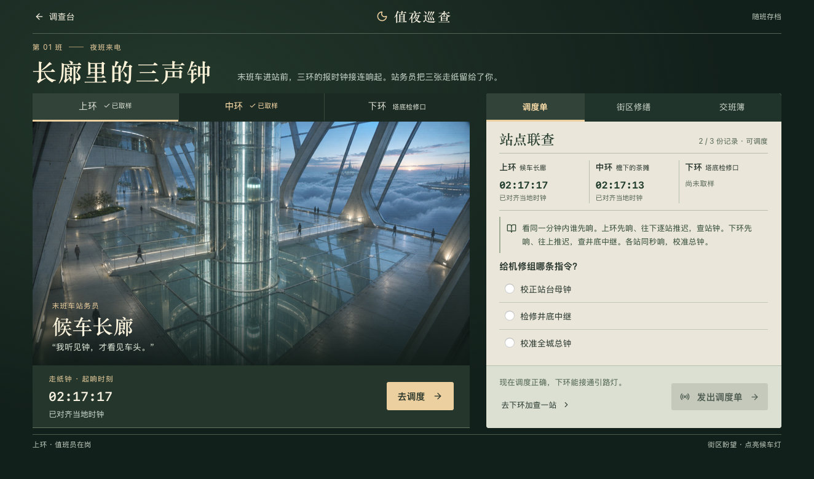

# 云深处 / The Deep Cloud

一座浮空城，三片高度不同的街区。下环栈桥听见了航道图上没有的回声。你是当班观察者，得弄清云层底下究竟有什么，再决定零号月台的末班车能不能出发。

*A science-fiction investigation game in Chinese. Follow five linked cases through a floating city, then take the night shift for its residents.*

**[在线游玩](https://lunora-gather.github.io/YunShenChu/)** · [直接进入值夜巡查](https://lunora-gather.github.io/YunShenChu/#watch) · [下载离线版 ZIP](https://lunora-gather.github.io/YunShenChu/downloads/The-Deep-Cloud.zip)

## 第一次当班

1. 在标题画面点「开始调查」，前往下环。可以点画面里的「沿栈桥往下」走近现场，也可以用现场下方的「追踪云下回波」打开接收器。
2. 锁定信号后，按现场提示使用仪器。卡住时，底栏会标出当前续办的案名和下一步，仪器也有可展开的提示。
3. 每案有三份记录。提交结论时，从两份不同来源的记录中各引用一项证据。五案归档后，再从每案选出一条记录复原发车清单，作出最后的调度决定。

## 五案之后，城里还有人值夜

「值夜巡查」从第一晚就可以单独玩。一班接一通来电，去三环里的两站取样。依据读数调度正确，剩下的一站就有人手修缮。加查第三站能多一份把握，也会用完这班的人手。

九项街区设施逐步修好，夜邮换签、电台点播也会加入轮值。每四班可以约定下一轮的值守目标。交班簿保留最近十二班的原始读数和处置结果，随时可以翻回去看当时的判断。

五案归档后，三个街区的居民各有三封连续来信。一趟委托跨两班，先看承重选承运人，再按路线接车或核验封缄。熟悉的街坊可以帮忙代抄读数，跑熟的路线还会带来回程货。收到的签收回信可以在街区修缮簿里重读。

## 续玩与换设备

进度随当前浏览器和网址自动保存，中途离开也能接着办案或交班。想体验另一种结局，可以从标题画面打开独立重玩档。

换浏览器、换设备，或从网页版转到离线版时，先从「管理存档」下载备份，再在目标位置选择备份、核对预览并合并进度。合并会保留目标存档已有的结局。

macOS 上解压离线包后，双击「打开云深处.command」。启动器使用 Python 3 在本机打开 Safari，游玩时保留启动窗口。

## 开发与世界观

游戏使用 React、TypeScript 和 Vite。运行、测试、制作离线包及发布步骤见[开发说明](SkyCity/README.md)。想了解城里的街区与派系，可从[云深处编年史](docs/history.md)和[城市治理](docs/governance.md)读起。

仓库目前未声明许可证。
